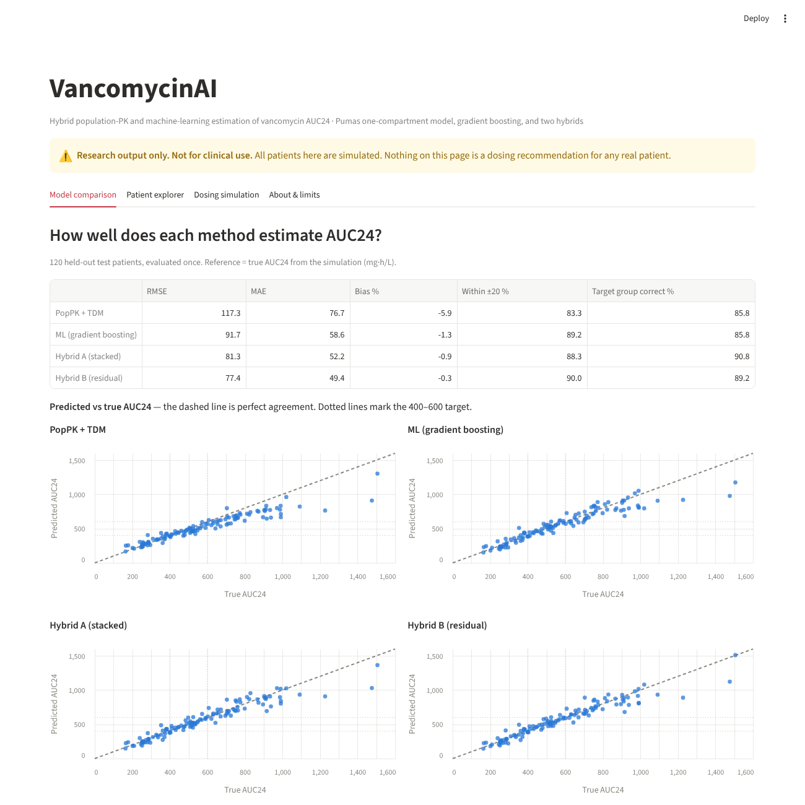
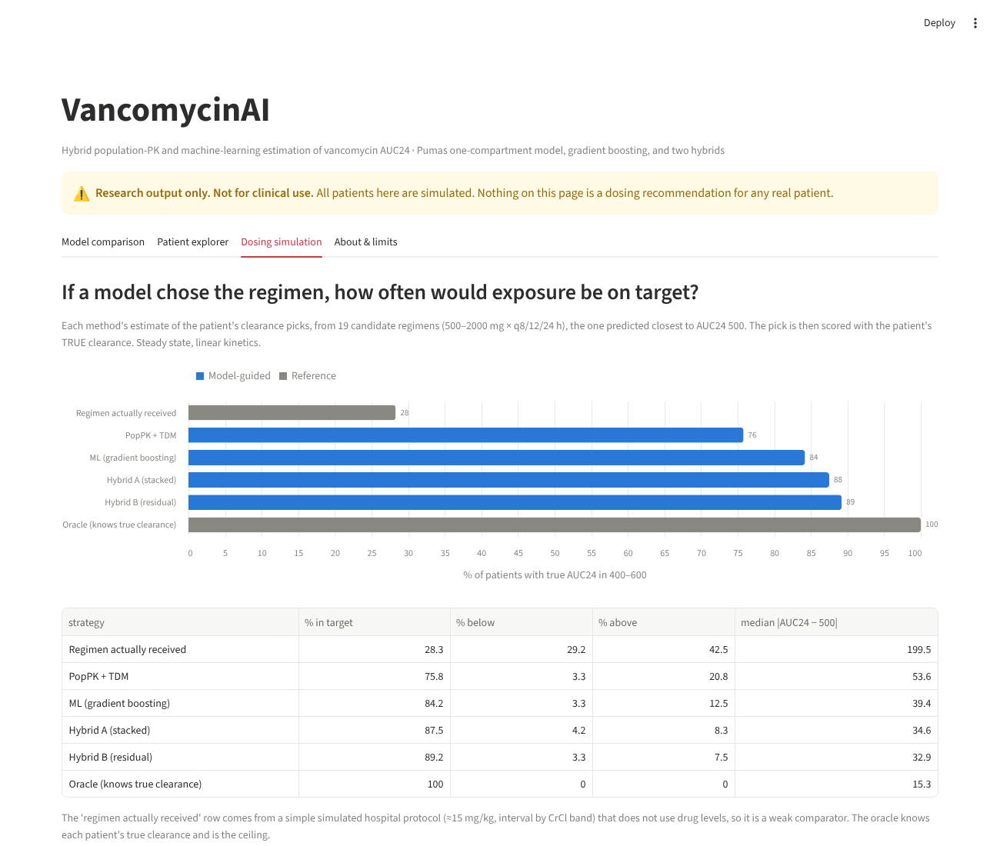

# VancomycinAI

**A hybrid population pharmacokinetic (PopPK) and machine-learning framework for estimating vancomycin AUC24 from therapeutic drug monitoring (TDM) data.**

> **Research use only.** All data are simulated. Nothing in this repository is a dosing recommendation for any real patient.

## What this project does

1. **Simulates** 600 adult inpatients with sparse vancomycin TDM samples from a two-compartment model with nonlinear covariate effects (so the ground-truth AUC24 is known).
2. **Fits a one-compartment PopPK model in Pumas (Julia)**, deliberately simpler than the truth, and estimates each patient's clearance from their own samples (empirical Bayes).
3. **Trains machine-learning models** (ridge, random forest, gradient boosting) on covariates, regimen and TDM concentrations.
4. **Builds two hybrids:** (A) PopPK estimates fed into ML as extra inputs; (B) ML predicts a correction to the PopPK estimate.
5. **Compares everything on a held-out test set** with paired-bootstrap confidence intervals.
6. **Simulates dosing:** how often would a model-chosen regimen put true exposure in the 400-600 mg*h/L target?
7. **Presents results in a Streamlit dashboard.**



## Results (120 held-out test patients, evaluated once)

AUC24 estimation error against the true simulated AUC24 (mg*h/L):

| Method | RMSE | MAE | Within 20% | Target group correct |
|---|---|---|---|---|
| PopPK + TDM | 117 | 77 | 83% | 86% |
| ML (gradient boosting) | 92 | 59 | 89% | 86% |
| Hybrid A (stacked) | 81 | 52 | 88% | 91% |
| Hybrid B (residual) | 77 | 49 | 90% | 89% |

Hybrid B versus PopPK alone: MAE difference -27.1 (95% interval -37.5 to -17.0); RMSE difference -39.6 (95% interval -52.4 to -25.7). Gains in "within 20%" and target-group agreement were suggestive but not clearly different from zero at n = 120.

**Dosing simulation.** Each method's clearance estimate selects, from 19 candidate regimens (500-2000 mg x q8/q12/q24h), the one predicted closest to AUC24 500; the pick is scored with the patient's true clearance:

| Strategy | In target (400-600) | Below | Above |
|---|---|---|---|
| Regimen actually received | 28% | 29% | 42% |
| PopPK + TDM | 76% | 3% | 21% |
| ML (gradient boosting) | 84% | 3% | 12% |
| Hybrid A (stacked) | 88% | 4% | 8% |
| Hybrid B (residual) | 89% | 3% | 8% |
| Oracle (knows true clearance) | 100% | 0% | 0% |

The "regimen actually received" row comes from a simple simulated protocol that does not use drug levels, so it is a weak comparator. The oracle knows each patient's true clearance and is the ceiling.



## Reproduce

Python 3.10+ and Julia with Pumas (see below). Run from the repository root, in this order:

```bash
pip install -r requirements.txt
python simulate_vancomycin.py     # 1. simulated data -> data/
python ml_baseline.py             # 2. ML baseline -> data/ml_test_auc24.csv
```
```julia
# 3. In Julia with Pumas loaded (needs a Pumas licence):
include("pumas_fit_onecmt.jl")    # fits the PopPK model on the training patients
include("pumas_poppk_test.jl")    # scores it on the held-out test patients
```
```bash
python hybrid_eval.py             # 4. hybrids + bootstrap
python dosing_simulation.py       # 5. dosing simulation
streamlit run app.py              # 6. dashboard
```

The generated CSVs are committed in `data/`, so the dashboard runs without Pumas.

## Repository layout

| File | Purpose |
|---|---|
| `simulate_vancomycin.py` | Simulated TDM dataset and ground truth |
| `pumas_fit_onecmt.jl`, `pumas_poppk_test.jl` | Pumas PopPK fit and held-out evaluation |
| `ml_baseline.py` | Leakage-safe ML baseline |
| `hybrid_eval.py` | Hybrid models and paired bootstrap |
| `dosing_simulation.py` | Regimen-selection simulation |
| `app.py` | Streamlit dashboard |
| `data/` | Simulated data and result files |
| `docs/` | Dashboard screenshots |

## Simulation assumptions

- **Truth model:** two-compartment IV infusion. Typical CL 5.0 L/h (CrCl 100 mL/min, age 60), V1 30 L, Q 6 L/h, V2 40 L (70 kg). Log-normal between-patient variability: CL 30%, V1 25%, Q 30%, V2 30%.
- **Deliberate misspecification:** saturating CrCl effect and a linear age effect on CL; ICU status raises V1 by 30%. A one-compartment power-law model is therefore structurally wrong, which leaves room for ML and hybrids to help.
- **Residual error:** 10% proportional plus 1 mg/L additive.
- **Dosing and sampling:** about 15 mg/kg rounded to 250 mg; interval by CrCl band with 12% clinician deviation; sparse samples in the last interval (trough in 85% of patients, post-infusion peak in 55%).
- **Ground truth:** steady-state AUC24 = daily dose / true clearance.

## Evaluation rules (leakage control)

- Patients 1-480 train, 481-600 test. The split is by patient and fixed.
- Model selection uses 5-fold cross-validation grouped by patient inside the training set only; the test set is scored once.
- Features contain only information available at the time of sampling. The true parameters are used only as the training label and for scoring.

## Limitations

- Simulated data cannot show clinical validity. External validation on licensed, de-identified clinical data is the next step.
- The ML models are trained on the true AUC24; real data would offer only a model-derived reference.
- PopPK estimates for training patients are in-sample (the model was fitted on them); cross-fitting would be cleaner. PopPK accuracy was similar on train and test, so the effect appears small.
- The PopPK model is deliberately misspecified, so a correction layer has something to fix by design. The results show the framework works, not that hybrids beat PopPK on real patients.
- One simulated dataset and 120 test patients; steady state and linear kinetics are assumed in the dosing simulation.

## Roadmap

- DeepPumas neural-network-embedded hybrid
- Covariate analysis
- Repeat across several simulation seeds
- External validation on real TDM data
- Manuscript

## Software and licences

Pumas and DeepPumas are products of PumasAI and require a licence (PumasAI offers academic access for non-commercial research and education). The software and any licence keys are **not** included in this repository.
